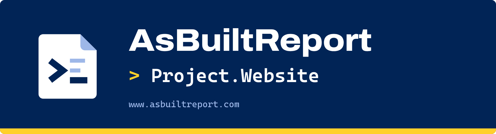
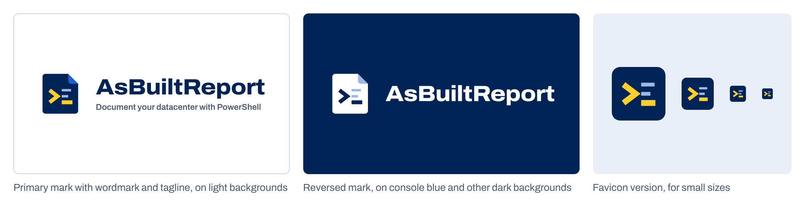
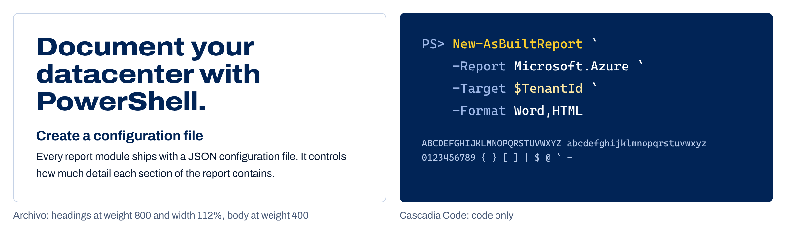

    

This repository is for hosting the [AsBuiltReport project website](https://www.asbuiltreport.com).

The project website is built using [Material for MkDocs](https://squidfunk.github.io/mkdocs-material/), together with [ProperDocs](https://github.com/ProperDocs/properdocs).

## Branding

The website carries the AsBuiltReport brand: a PowerShell prompt on a sheet of paper, the classic PowerShell console blue, and a highlighter yellow taken from the health check highlights in a report.

Tagline: **Document your datacenter with PowerShell**

### Logo

The chevron and cursor read as a PowerShell prompt. Together with the two lines above the cursor they read as lines of a document.

| File | Use |
|---|---|
| [`asbuiltreport-mark.svg`](docs/assets/images/logos/asbuiltreport-mark.svg) | Primary mark, for light backgrounds |
| [`asbuiltreport-mark-reversed.svg`](docs/assets/images/logos/asbuiltreport-mark-reversed.svg) | White version for console blue and other dark backgrounds. Used in the site header |
| [`asbuiltreport-mark.png`](docs/assets/images/logos/asbuiltreport-mark.png) | 512 px PNG of the primary mark, for places that do not accept SVG |
| [`favicon.svg`](docs/assets/images/logos/favicon.svg), [`favicon.png`](docs/assets/images/logos/favicon.png) | Simplified square version for small sizes. Used as the site favicon |

All logo files are in [`docs/assets/images/logos`](docs/assets/images/logos).

Guidelines:

- Use the reversed mark on any dark background. The primary mark's blue page disappears there.
- Below 24 px, use the favicon version. The two document lines in the full mark do not survive at that size.
- The wordmark is "AsBuiltReport" set in Archivo at weight 800 and width 112%, in one colour.
- Do not recolour, stretch or rotate the mark.

### Repository banner

Every repository README opens with the same banner as the organisation profile: the reversed mark, the wordmark, the repository name in Cascadia Code with a yellow prompt, and a yellow edge. Module repositories show their install command on the last line, for example `PS> Install-Module AsBuiltReport.VMware.vSphere`. This repository has no PowerShell install, so it shows the website address instead.

| File | Use |
|---|---|
| [`repo-banner.png`](docs/assets/images/brand/repo-banner.png) | This repository, 1760 x 480 shown at 880 px wide |

### Colours

| Swatch | Name | Hex | Use |
|:---:|---|---|---|
|  | Console blue | `#012456` | Header, hero, headings, code blocks, table headings |
|  | Highlighter | `#FFD02B` | Primary buttons, step numbers, icon tiles, commands in code, the cursor bar under headings |
|  | Highlighter tint | `#FFE9A3` | Health check highlight (`==text==` in Markdown), strings in code |
|  | Link blue | `#1F5FD0` | Links on light backgrounds |
|  | Parameter | `#9DB7E8` | Parameters and comments in code, rules on blue |
|  | Tracing | `#E9EFF8` | Inline code and quiet panels in light mode |
|  | Ink | `#0A1A33` | Body text in light mode |
|  | Slate | `#4A5B78` | Secondary text in light mode |
|  | Rule | `#C5D2E6` | Borders and table rules in light mode |

Dark mode keeps console blue and highlighter and swaps the neutrals:

| Swatch | Name | Hex | Use |
|:---:|---|---|---|
|  | Page | `#06142B` | Page background |
|  | Surface | `#0B2147` | Panels and bands |
|  | Border | `#24406F` | Borders and table rules |
|  | Text | `#E6EDF8` | Body text |
|  | Muted | `#A9BCDD` | Secondary text |
|  | Link | `#8AB4FF` | Links |

Yellow is never used for text on a light background, because the contrast is too low. On light backgrounds it is a fill with console blue text or icons on top.

### Typography

| Typeface | Use | Notes |
|---|---|---|
| [Archivo](https://fonts.google.com/specimen/Archivo) | Headings and body text | Headings at weight 800 and width 112%. Body at weight 400 |
| [Cascadia Code](https://github.com/microsoft/cascadia-code) | Code only | The Windows Terminal typeface |

Both typefaces are self-hosted in [`docs/assets/fonts`](docs/assets/fonts) under the SIL Open Font License, so the site makes no requests to a font service. The licence files are in the same folder.

### Where the brand is defined

| File | What it controls |
|---|---|
| [`docs/assets/stylesheets/extra.css`](docs/assets/stylesheets/extra.css) | Colours, fonts, light and dark schemes, code block and table styles, and the home page layout. The brand colours are set once at the top of the file |
| [`overrides/home.html`](overrides/home.html) | The home page hero |
| [`docs/index.md`](docs/index.md) | The home page sections below the hero, in Markdown |
| [`properdocs.yml`](properdocs.yml) | Logo, favicon, light and dark palette toggle, and social card colours |

When `extra.css` changes, update the version on its path under `extra_css` in `properdocs.yml` (currently `extra.css?v=2026.11.13`), so browsers fetch the new file and do not use a cached copy.
